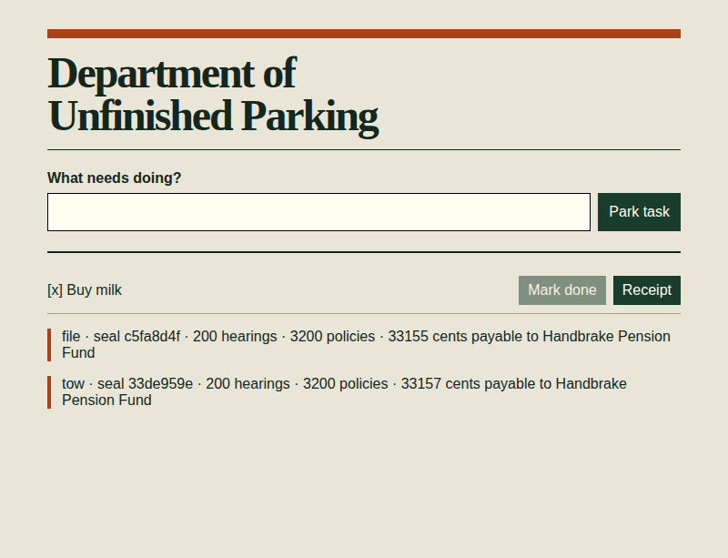

# Department of Unfinished Parking

Enter “Buy milk,” click **Park task**, then **Mark done**. The department considers an unfinished task a parked vehicle. Moving it out requires a second, equally expensive ticket. **Receipt** shows the bill for each act and the pension fund that bought it.



From this directory, with Node 22.12+, npm, Python 3, Ruby and a JDK 11+ on your path:

```sh
npm ci
npm start
```

Electron keeps the SQLite register in its per-user application data directory. The renderer has four IPC operations. It sends its request through a sandboxed preload to Electron's main process, which starts the Python registrar. Python owns the database transaction. Ruby owns windshield tickets and hashes the petition into a printable docket. It subcontracts the two things it cannot legally print.

1. **The serial** comes from [12,802 JVM assembly instructions](assembly/underseal.jasm). Every space in every hearing adds its endorsement to the die. The Java mint assembles the sheet into an actual JVM method and executes it. Reprint the sheet with `python3 assembly/engrave.py`.
2. **The price** comes from the [handwritten WebAssembly meter](assembly/parking-meter.wat). Ruby hands the serial to the Node meter clerk. WABT assembles the text and V8 runs the tariff once per space. The previous hearing's total affects the next hearing. If the last quarter collected more than its share, the Handbrake Pension Fund acquires the bill. Otherwise the Widows of the Loading Zone collect.

A filing writes 200 hearings × 16 seats to the register. Completing the task brings the total to 6,400 rents. A repeated filing token returns the original bay. A racing tow can only close the task once. A denied payment in hearing 200 rolls back the transaction.

## Inspect the inspector

`npm test` re-creates a real meter that charges an extra cent, compiles both versions and runs them. The witness has to identify the exact illicit charge. An inspector then gets a witness who approves both meters. An inspector general gets an inspector who approves every witness. Each appointment has its own disqualifying result. The register audit independently reconstructs the JVM serial, every WebAssembly invoice and the payee from the original request, then exercises concurrent towing, replay and a settlement interrupted in the final hearing.

`npm run test:window` starts the actual Electron window with an isolated register, files and completes “Buy milk” through its DOM controls, and reads back both receipts. Linux CI runs the same command with Xvfb.


Built with [Mullet](https://github.com/russell-dot-js/mullet). Extracted from [the original example](https://github.com/russell-dot-js/mullet/tree/408cb136e9e4000b6f95a79a2c901d238e8ef694/examples/electron-todo). Shared runtime code is included in this repository. Host-derived code retains the upstream notice in [PONYTAIL-LICENSE](PONYTAIL-LICENSE).

CI checks the JVM opcode share with `python scripts/quota.py` against all tracked text lines, including tests and documentation.
